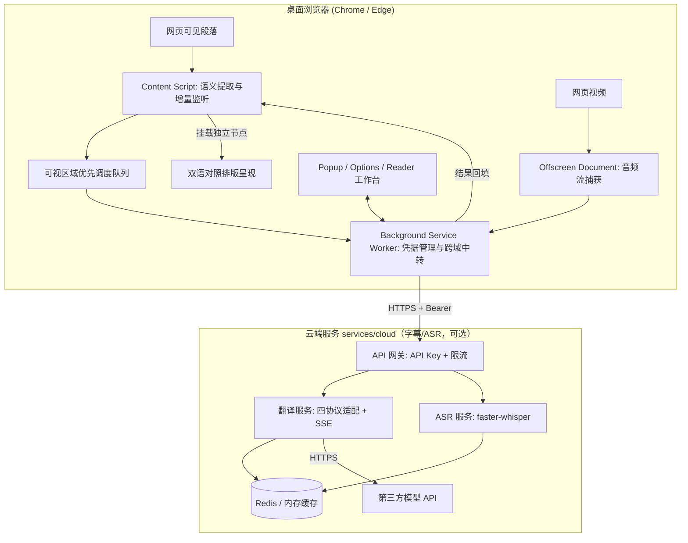

# 译舟 (TransArk) - 隐私优先的 AI 智能双语伴读与音视频翻译

<div align="center">


**轻舟渡语界，方舟护隐私。**  
为桌面浏览器打造的轻量级、跨协议、端到端全场景智能翻译系统。

[功能特性](#-功能特性) • [系统架构](#-系统架构) • [快速开始](#-快速开始) • [开发与测试](#-开发与测试) • [隐私安全规范](#-隐私与安全承诺) • [使用教程](./docs/TUTORIAL.md)

</div>

---

## 📖 项目简介

**译舟 (TransArk)** 是一款专为桌面浏览器（Chrome / Edge）设计的现代化智能翻译系统。与传统重度依赖云端第三方的翻译插件不同，译舟主打**隐私优先（Privacy-First）**与**严格的数据边界控制**：

1. **原境双语阅读**：智能扫描网页语义块，保留原网页 DOM 结构、原生排版与交互事件，实现独立节点双语并列呈现与一键毫秒级撤销/恢复。
2. **本地文档工作台**：内置双语阅读工作台，支持本地 `.txt`、`.md`、`.docx` 的浏览器内解析与对照阅读；PDF/扫描件解析由独立的本地伴随服务 API 提供，扩展阅读器暂不直接支持。
3. **视频双语字幕与实时 ASR**：依附 HTML5 视频播放器的悬浮双语字幕；字幕来源按“内嵌轨道 → YouTube 适配器 → 本地 SRT/VTT 上传 → 云端实时 ASR”回退，原文与译文同步显示。
4. **统一跨协议模型适配**：仅保留 **API 接入**，适配市面主流协议——OpenAI Chat Completions（事实标准，兼容 DeepSeek / Kimi / 通义 / vLLM / One-API 等网关）、OpenAI Responses、Anthropic Messages 与 Google Gemini；支持一键拉取模型列表并自主选择。连接本机 Ollama / vLLM 时，同样使用 API 接入并把 BaseUrl 指向回环地址。
5. **可选本地伴随服务**：`services/local` 是独立的 FastAPI 后端，提供 PDF/OCR/ASR、长任务与 `NetworkGuard` 出口守卫；扩展当前不直接调用它，云端字幕链路使用 `services/cloud`。

---

## 🌟 核心特性

- 🛡️ **Profile 数据标注**：保留 `device-only` / `allow-lan` / `allow-cloud` 字段描述数据去向；当前扩展不做网络出口拦截，`NetworkGuard` 仅在独立的本地伴随服务中生效。
- ⚡ **视口优先调度 + 流式回填**：基于 `IntersectionObserver` 的自适应可视区域队列，屏幕内段落插队优先翻译；配合 SSE 流式解析，**每段一到达即回填**，无需等待整批完成。失败批次自动指数退避重试。
- 🔄 **防动态回填污染**：32 位 FNV-1a 增量哈希校验机制；网页动态渲染（SPA 路由切换、虚拟列表复用）期间原段落内容变动时自动丢弃陈旧译文。
- 🎬 **视频双语字幕**：内嵌轨道、YouTube `captionTracks`、SRT/VTT 上传与云端流式 ASR 四级回退；Shadow DOM 浮层同步渲染原文/译文。
- 🤝 **本地服务安全（独立后端）**：`services/local` 采用 8 位配对码 + 内存 Bearer 令牌 + 失败锁定，防御回环服务的未授权调用；扩展不再提供“本地接入”模式。
- 📦 **零外部 CDN 脚本**：扩展 UI、样式与依赖 100% 内联打包（当前产物约 463 kB），符合 Chrome 应用商店无远程代码安全规范。

---

## 🎬 视频字幕与云端服务（方案 A）

视频双语字幕采用 **云端翻译 + 云端 ASR** 的方案落地：

- **有字幕**：优先读取 `<video>` 内嵌字幕轨，其次 YouTube `captionTracks` 站点适配器，再次 Popup 中导入的 SRT/VTT；字幕译文经云端 `/v1/subtitles/translate` 以 SSE 逐 cue 回填，原文与译文在 Shadow DOM 悬浮层中双语同时展示。
- **无字幕**：扩展通过 `tabCapture` 捕获当前标签页音频，经 Offscreen Document 转为 16kHz PCM，通过 WebSocket 送入云端 ASR，识别出的 cue 立即上屏并接续翻译。
- **服务端不部署大模型**：翻译转发至第三方 API（OpenAI Chat / Responses、Anthropic、Gemini），ASR 使用 faster-whisper int8，模型按需加载；Redis 为可选缓存。

```bash
# 启动云端服务（默认 0.0.0.0:8780）
cd services/cloud
pip install -e ../local -e ".[asr,cache]"
CLOUD_API_KEYS=dev-key CLOUD_PROVIDER_API_KEY=sk-... python -m cloud_service
```

在扩展设置 →「常规偏好」中填写云端地址与 API Key 后，Popup 会出现「视频双语字幕」开关。

- 云端服务说明：[`services/cloud/README.md`](./services/cloud/README.md)
- 视频字幕支持范围与限制：[`docs/VIDEO_SUBTITLE_SUPPORT.md`](./docs/VIDEO_SUBTITLE_SUPPORT.md)
- 方案 B（浏览器端 WASM ASR 隐私档）设计：[`docs/PLAN_B_BROWSER_WASM_ASR.md`](./docs/PLAN_B_BROWSER_WASM_ASR.md)

---

## 🏗️ 系统架构

项目基于 **pnpm Monorepo** 组织，前后端通过严格代码化的共享契约包完全解耦：

```text
transark/
├── packages/
│   └── contracts/          # 共享契约：TypeScript 类型定义、错误码与段落 ID 严格对齐校验工具
├── apps/
│   └── extension/          # 浏览器扩展：Chrome/Edge Manifest V3 (WXT + React + TailwindCSS)
├── services/
│   ├── local/              # 本地伴随服务：FastAPI (文档解析、OCR、ASR 与长任务引擎)
│   └── cloud/              # 云端服务：API Key 鉴权、字幕翻译 SSE、流式 ASR (方案 A)
├── docs/                   # 架构设计、通用 API 接入方案、详细使用教程与风险评估报告
└── tests/
    └── fixtures/           # 文档与字幕样本 (sample.txt / sample.srt)
```

### 数据流与执行拓扑



> `services/local` 是独立的本地伴随服务（PDF/OCR/ASR/NetworkGuard），扩展当前不调用它，因此未画入主链路；其接口见 [`services/local/README.md`](./services/local/README.md)。

---

## 🚀 快速开始

### 1. 前置依赖
- [Node.js](https://nodejs.org/) >= 18.0.0
- [pnpm](https://pnpm.io/) >= 9.0.0
- [Python](https://www.python.org/) >= 3.11（运行本地伴随服务或云端服务时需要）

### 2. 获取代码与安装依赖
```bash
git clone https://github.com/fengzhiyushui/transark.git
cd transark

# 安装 Monorepo 全量依赖
pnpm install
```

### 3. 构建共享契约与浏览器扩展
```bash
# 1. 编译共享契约包
pnpm --filter @translate/contracts build

# 2. 编译浏览器扩展 (产物位于 apps/extension/.output/chrome-mv3)
pnpm --filter @translate/extension build
```

### 4. 加载到浏览器
1. 打开 Chrome 或 Edge，访问 `chrome://extensions/` 或 `edge://extensions/`。
2. 开启页面右上角的 **「开发者模式 (Developer Mode)」**。
3. 点击 **「加载已解压的扩展程序 (Load unpacked)」**。
4. 选择目录：`apps/extension/.output/chrome-mv3`。
5. 安装完成！点击浏览器右上角扩展栏的「译舟」图标即可开启使用。

### 5. 启动本地伴随服务（独立后端，可选）

`services/local` 提供 PDF 解析、OCR、ASR、长任务与 `NetworkGuard`，但**扩展当前不直接调用它**。若只需网页翻译，可跳过本节；视频字幕请使用下一步的云端服务。

```bash
cd services/local
python -m venv .venv
source .venv/bin/activate  # Windows: .venv\Scripts\activate
pip install -e .
python -m local_service    # 仅监听 127.0.0.1:8765
```

### 6. 启动云端服务（视频字幕 / ASR，可选）

```bash
cd services/cloud
pip install -e ../local -e ".[asr,cache]"
CLOUD_API_KEYS=dev-key CLOUD_PROVIDER_API_KEY=sk-... python -m cloud_service
```

完整部署（systemd / Docker / Nginx / 排错）见 [`docs/SERVER_DEPLOYMENT.md`](./docs/SERVER_DEPLOYMENT.md)。

---

## 🧪 开发与测试

项目具备严密的自动化测试覆盖体系，全仓库共计 **190+ 项端到端及单元测试用例**（扩展 92 + 契约 7 + 本地服务 77 + 云端服务 18）：

```bash
# 全仓库测试（需先按上文安装 Python 依赖，否则后端 pytest 会失败）
pnpm test

# 全局 TypeScript 严格类型检查 (0 报错)
pnpm typecheck

# 仅运行扩展端单测
pnpm --filter @translate/extension test

# 仅运行契约测试
pnpm --filter @translate/contracts test

# 仅运行本地伴随服务 77 项 pytest 测试
cd services/local && python -m pytest

# 仅运行云端服务 18 项 pytest 测试
cd services/cloud && python -m pytest

# 云端真实 HTTP + WebSocket 冒烟（自启 echo + mock ASR）
cd services/cloud && python scripts/smoke_e2e.py --spawn
```

---

## 🔒 隐私与安全承诺

译舟项目将用户数据安全与合规放在首要位置：

1. **端侧处理范围**：网页段落扫描、哈希校验与 DOM 挂载在浏览器本地完成；Reader 的 TXT/MD/DOCX 解析在扩展沙盒内完成。启用云端字幕/翻译时，原文或音频会发送到你在设置中配置的云端服务。
2. **凭据隔离**：扩展侧的模型 API Key 仅保存在 `chrome.storage.local`，不注入网页 DOM；云端服务的第三方 Provider Key 只存放于服务端环境变量，绝不下发到客户端。
3. **无静默回退**：扩展只请求当前 Profile 的 BaseUrl；云端服务按 `profileId` 选择 Provider，不自动切换。`NetworkGuard` 出口守卫仅存在于独立的本地伴随服务中，扩展本身不做出口拦截。
4. **云端部署要求**：生产环境应启用 HTTPS、强 API Key、限流与出站白名单；详见 [部署教程](./docs/SERVER_DEPLOYMENT.md)。
5. **详尽风险与防范说明**：请参阅 [安全与风险防范审计报告](./docs/SECURITY_AND_RISK_AUDIT.md)。

---

## 📚 文档指南

- [完整使用教程 (TUTORIAL.md)](./docs/TUTORIAL.md)：包含网页翻译、本地文档双语阅读、视频字幕配置与模型接入的详细图文指引。
- [安全与风险防范审计 (SECURITY_AND_RISK_AUDIT.md)](./docs/SECURITY_AND_RISK_AUDIT.md)：深入分析权限、CSRF、路径遍历与大模型提示词注入风险。
- [实施路线图 (ROADMAP)](./docs/browser-translation-roadmap-2026-10-10.md)：功能规划与演进设计。
- [通用 API 接入方案 (API INTEGRATION)](./docs/browser-translation-api-integration-2026-10-10.md)：多模型与网关协议规范。
- [方案 B：浏览器端 WASM ASR 设计](./docs/PLAN_B_BROWSER_WASM_ASR.md)：隐私档位的适用场景、实施步骤与 A/B 对比。
- [视频字幕支持范围与限制](./docs/VIDEO_SUBTITLE_SUPPORT.md)：YouTube 适配、通用 textTracks、上传与 ASR 回退、DRM/iframe 限制。
- [云端服务部署教程](./docs/SERVER_DEPLOYMENT.md)：运行环境、依赖安装、环境变量、systemd/Docker/Nginx、验证与排错。

---

## 🤝 参与贡献

欢迎提交 Issue 和 Pull Request！请查阅 [贡献指南 (CONTRIBUTING.md)](./CONTRIBUTING.md) 与 [行为准则 (CODE_OF_CONDUCT.md)](./CODE_OF_CONDUCT.md)。

---

## 📄 开源许可证

本项目采用 [GNU General Public License v3.0 (GPLv3)](./LICENSE) 开源发布。任何人均可自由学习、使用与改进本系统，基于本项目的衍生分发版本必须同样开源其全部源码。
