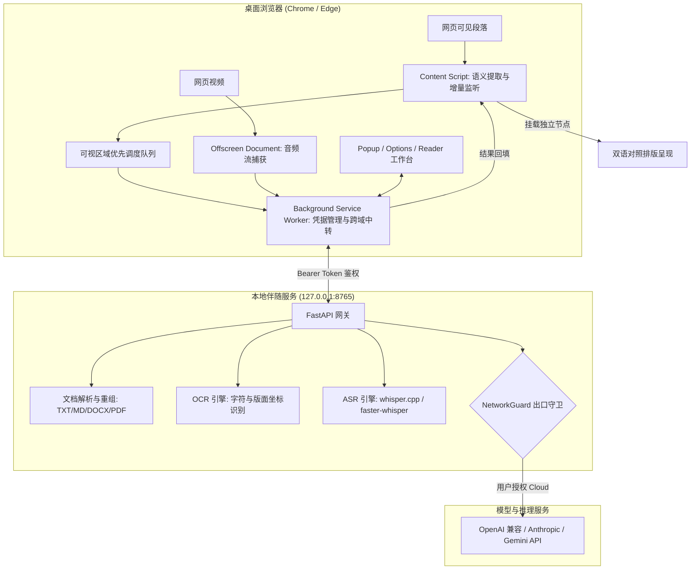

# 译舟 (TransArk) - 隐私优先的 AI 智能双语伴读与音视频翻译

<div align="center">


**轻舟渡语界，方舟护隐私。**  
为桌面浏览器打造的轻量级、跨协议、端到端全场景智能翻译系统。

[功能特性](#-功能特性) • [系统架构](#-系统架构) • [快速开始](#-快速开始) • [开发与测试](#-开发与测试) • [隐私安全规范](#-隐私与安全承诺) • [使用教程](./docs/TUTORIAL.md)

</div>

---

## 📖 项目简介

**译舟 (TransArk)** 是一款专为桌面浏览器（Chrome / Edge）设计的现代化智能翻译系统。与传统重度依赖云端第三方的翻译插件不同，译舟主打**本地优先（Local-First）**与**严格隐私边界保护**：

1. **原境双语阅读**：智能扫描网页语义块，保留原网页 DOM 结构、原生排版与交互事件，实现独立节点双语并列呈现与一键毫秒级撤销/恢复。
2. **本地文档工作台**：内置独立的双语阅读工作台，支持本地 `.txt`、`.md`、`.docx` 以及带版面坐标的 `.pdf` 文档解析与对照阅读，零依赖本地导出。
3. **视频双语字幕与实时 ASR**：依附 HTML5 视频播放器的悬浮双语字幕；配合本地伴随服务与 `whisper.cpp`，实现无字幕音视频的实时离线语音识别与双语对齐。
4. **统一跨协议模型适配**：仅保留**本地接入**与 **API 接入**两种接入方式。API 接入适配市面主流协议——OpenAI Chat Completions（事实标准，兼容 DeepSeek / Kimi / 通义 / vLLM / One-API 等网关）、OpenAI Responses、Anthropic Messages 与 Google Gemini；支持一键拉取模型列表并自主选择。本地接入入口保留，底层适配尚未提供。
5. **绝对离线与出口守卫（NetworkGuard）**：内置物理级网络守卫，在离线模式下严禁静默回退到外网云端，彻底杜绝企业机密与个人敏感文档泄露。

---

## 🌟 核心特性

- 🛡️ **严格数据策略**：明确区分 `device-only`（仅限本机）、`allow-lan`（允许局域网）与 `allow-cloud`（允许云端）。离线状态下违规外网请求直接阻断并抛出 `POLICY_VIOLATION`。
- ⚡ **视口优先调度 + 流式回填**：基于 `IntersectionObserver` 的自适应可视区域队列，屏幕内段落插队优先翻译；配合 SSE 流式解析，**每段一到达即回填**，无需等待整批完成。失败批次自动指数退避重试。
- 🔄 **防动态回填污染**：32 位 FNV-1a 增量哈希校验机制；网页动态渲染（SPA 路由切换、虚拟列表复用）期间原段落内容变动时自动丢弃陈旧译文。
- 🤝 **安全回环配对**：本地伴随服务采用动态 8 位验证码 + 内存 Bearer 令牌鉴权机制，防御外部恶意网页伪造 CSRF 调用。
- 📦 **零外部 CDN 脚本**：扩展所有 UI、样式与依赖 100% 内联打包（产物体积 < 400 kB），完全符合 Chrome 应用商店无远程代码安全规范。

---

## 🏗️ 系统架构

项目基于 **pnpm Monorepo** 组织，前后端通过严格代码化的共享契约包完全解耦：

```text
transark/
├── packages/
│   └── contracts/          # 共享契约：TypeScript 类型定义、错误码与段落 ID 严格对齐校验工具
├── apps/
│   └── extension/          # 浏览器扩展：Chrome/Edge Manifest V3 (WXT + React + TailwindCSS)
├── services/
│   └── local/              # 本地伴随服务：FastAPI 异步架构 (文档解析、OCR、ASR 与长任务引擎)
├── docs/                   # 架构设计、通用 API 接入方案、详细使用教程与风险评估报告
└── tests/
    └── fixtures/           # 标准测试样本 (文档、字幕、音视频片段)
```

### 数据流与执行拓扑



---

## 🚀 快速开始

### 1. 前置依赖
- [Node.js](https://nodejs.org/) >= 18.0.0
- [pnpm](https://pnpm.io/) >= 9.0.0
- [Python](https://www.python.org/) >= 3.11（若需要运行本地伴随服务）

### 2. 获取代码与安装依赖
```bash
git clone https://github.com/fengzhiyushui/transark.git
cd transark

# 安装 Monorepo 全量依赖
pnpm install
```

### 3. 构建共享契约与浏览器扩展
```bash
# 1. 编译共享契约包
pnpm --filter @translate/contracts build

# 2. 编译浏览器扩展 (产物位于 apps/extension/.output/chrome-mv3)
pnpm --filter @translate/extension build
```

### 4. 加载到浏览器
1. 打开 Chrome 或 Edge，访问 `chrome://extensions/` 或 `edge://extensions/`。
2. 开启页面右上角的 **「开发者模式 (Developer Mode)」**。
3. 点击 **「加载已解压的扩展程序 (Load unpacked)」**。
4. 选择目录：`apps/extension/.output/chrome-mv3`。
5. 安装完成！点击浏览器右上角扩展栏的「译舟」图标即可开启使用。

### 5. 启动本地伴随服务（可选）
若需体验文档深度解析、本地 Whisper ASR 语音识别与全离线模式：
```bash
cd services/local

# 创建并激活 Python 虚拟环境 (可选推荐)
python -m venv .venv
source .venv/bin/activate  # Linux/macOS
# .venv\Scripts\activate   # Windows

# 安装伴随服务依赖
pip install -e .

# 启动本地伴随服务 (仅监听 127.0.0.1:8765)
python -m uvicorn local_service.app:app --host 127.0.0.1 --port 8765
```

---

## 🧪 开发与测试

项目具备严密的自动化测试覆盖体系，全仓库共计 **93 项端到端及单元测试用例**：

```bash
# 运行全仓库测试 (Contracts TS 测试 + Extension 单元测试 + Local Service pytest)
pnpm test

# 全局 TypeScript 严格类型检查 (0 报错)
pnpm typecheck

# 仅运行扩展端单测
pnpm --filter @translate/extension test

# 仅运行本地伴随服务 77 项 pytest 测试
cd services/local && python -m pytest
```

---

## 🔒 隐私与安全承诺

译舟项目将用户数据安全与合规放在首要位置：

1. **端侧计算优先**：文档解析、格式提取、分段哈希计算与译文挂载全在用户本地沙盒内完成；仅翻译请求本身按所选接入方式发出。
2. **凭据安全隔离**：第三方 API Key 仅保存在浏览器受保护的 `chrome.storage.local` 或本地伴随服务环境中，绝不注入普通网页 DOM，绝不在错误日志中打印明文。
3. **物理级出口拦截**：通过 `NetworkGuard` 严格限制网络出口。在无外网授权时，绝不静默向任何第三方上报或上传数据。
4. **详尽风险与防范说明**：请参阅 [安全与风险防范审计报告](./docs/SECURITY_AND_RISK_AUDIT.md)。

---

## 📚 文档指南

- [完整使用教程 (TUTORIAL.md)](./docs/TUTORIAL.md)：包含网页翻译、本地文档双语阅读、视频字幕配置与模型接入的详细图文指引。
- [安全与风险防范审计 (SECURITY_AND_RISK_AUDIT.md)](./docs/SECURITY_AND_RISK_AUDIT.md)：深入分析权限、CSRF、路径遍历与大模型提示词注入风险。
- [实施路线图 (ROADMAP)](./docs/browser-translation-roadmap-2026-10-10.md)：功能规划与演进设计。
- [通用 API 接入方案 (API INTEGRATION)](./docs/browser-translation-api-integration-2026-10-10.md)：多模型与网关协议规范。

---

## 🤝 参与贡献

欢迎提交 Issue 和 Pull Request！请查阅 [贡献指南 (CONTRIBUTING.md)](./CONTRIBUTING.md) 与 [行为准则 (CODE_OF_CONDUCT.md)](./CODE_OF_CONDUCT.md)。

---

## 📄 开源许可证

本项目采用 [GNU General Public License v3.0 (GPLv3)](./LICENSE) 开源发布。任何人均可自由学习、使用与改进本系统，基于本项目的衍生分发版本必须同样开源其全部源码。
