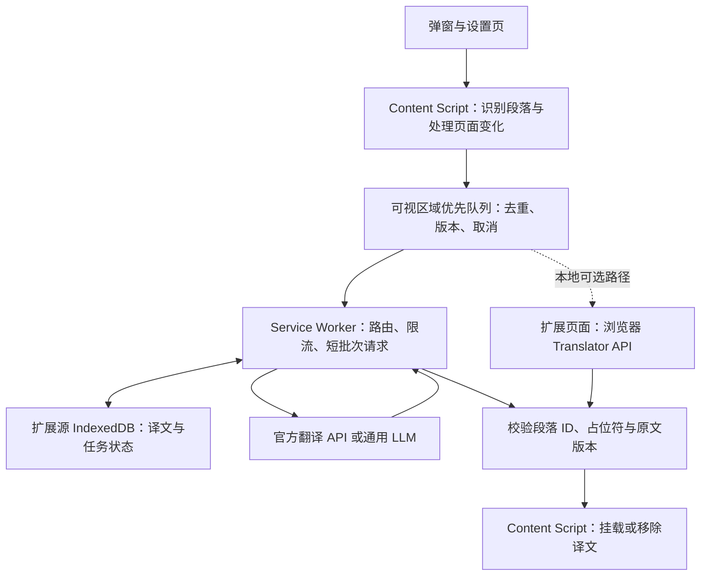

浏览器翻译插件开发技术调研

> **状态（2026-10-17 更新）**：本文为 2026-10-10 的历史调研存档。部分方案已被当前实现取代：扩展的“本地接入”模式已移除；视频字幕/ASR 采用 `services/cloud`；`services/local` 为独立后端，扩展不直接调用。当前行为以 [README](../README.md)、[TUTORIAL](./TUTORIAL.md)、[VIDEO_SUBTITLE_SUPPORT](./VIDEO_SUBTITLE_SUPPORT.md)、[SERVER_DEPLOYMENT](./SERVER_DEPLOYMENT.md) 为准。

范围更新：本报告保留最初的技术调研与有限网页 MVP 建议。当前最终目标已明确包含本地文件、离线处理、多种网页翻译、已有字幕与无字幕视频翻译，以及 AI 翻译；实施范围和阶段以[实施路线图](./browser-translation-roadmap-2026-10-10.md)为准，接口配置另见[通用 API 接入方案](./browser-translation-api-integration-2026-10-10.md)。本文原有工期估算不适用于扩大后的完整目标。

调研日期：2026-10-10。范围：以桌面 Chrome / Edge 的 Manifest V3 扩展为主，兼顾 Firefox / Safari 的迁移条件。依据为官方文档、公开仓库和许可证；本次未安装插件、执行构建或进行翻译质量与性能实测。下面的架构、优先级和工期属于工程建议。

建议从「技术文档和文章的中英双语阅读」切入，采用 WXT + TypeScript，先支持一个官方翻译 API，再通过统一适配层接入通用大模型与浏览器本地翻译。主要研发投入会集中在段落识别、动态网页兼容、译文回填和站点适配。模型可以替换，这些页面处理能力需要持续积累。

值得研究的项目如下，表中的复用条件需要和功能一起考虑。

| 项目 | 最有价值的研究内容 | 代码与平台现状 | 复用边界 |
| --- | --- | --- | --- |
| [沉浸式翻译](https://github.com/immersive-translate/immersive-translate/blob/main/README_english.md) | 双语阅读、站点规则、复杂页面适配 | 官方仓库用于发布与反馈，明确不包含产品源码 | 适合作产品和规则参考；无法从该仓库确认其内部框架与算法 |
| [KISS Translator](https://github.com/fishjar/kiss-translator) | 双语 DOM、选择器规则、批量请求和撤销翻译 | JavaScript / React；Chrome 为 MV3，Firefox 配置仍为 MV2 | GPLv3；允许商业使用，但分发修改版本需满足相应源码等义务 |
| [Read Frog](https://github.com/mengxi-ream/read-frog) | WXT / TypeScript 工程、段落分组、可视区域调度和 AI 请求队列 | 可见公开翻译核心源码；使用 React、WXT 等 | 扩展仓库提供 GPLv3 / 商业双授权；当前构建还包含有单独限制的专有依赖，完整 fork 需处理该依赖 |
| [TWP / Translate Web Pages](https://github.com/FilipePS/Traduzir-paginas-web) | 原位文本替换、恢复原文、服务适配和缓存 | 原生 JavaScript；主要官方安装目标是 Firefox，仓库 Chromium 配置仍为 MV2 | MPL-2.0，文件级 copyleft；适合研究算法，新 Chromium 项目需要重建 MV3 平台层 |
| [Linguist](https://github.com/translate-tools/linguist) | 模块化翻译服务、Bergamot 本地翻译 | TypeScript / React / Webpack；Chrome 配置为 MV3 | 当前同一提交的根 LICENSE 与 package.json 授权元数据不一致，复用前需澄清 |

具体源码入口及核查依据：

- KISS 的 [translationTargets.js](https://github.com/fishjar/kiss-translator/blob/753764f313660b33ddee72ca0130de5f42eef79e/src/libs/translationTargets.js) 负责自动扫描与选择器选择；[translator.js](https://github.com/fishjar/kiss-translator/blob/753764f313660b33ddee72ca0130de5f42eef79e/src/libs/translator.js) 管理译文容器、变化观察与恢复；[batchQueue.js](https://github.com/fishjar/kiss-translator/blob/753764f313660b33ddee72ca0130de5f42eef79e/src/libs/batchQueue.js) 聚合请求。[Chrome manifest](https://github.com/fishjar/kiss-translator/blob/753764f313660b33ddee72ca0130de5f42eef79e/public/manifest.json)、[Firefox manifest](https://github.com/fishjar/kiss-translator/blob/753764f313660b33ddee72ca0130de5f42eef79e/public/manifest.firefox.json) 与 [LICENSE](https://github.com/fishjar/kiss-translator/blob/753764f313660b33ddee72ca0130de5f42eef79e/LICENSE) 支持表中平台和授权结论。
- Read Frog 的 [translation-walker.ts](https://github.com/mengxi-ream/read-frog/blob/80140eaab2f8ddf35d2182f22ba6c6d296232cb5/src/utils/host/translate/core/translation-walker.ts) 将块级元素及连续行内节点组织成翻译单元；[page-translation.ts](https://github.com/mengxi-ream/read-frog/blob/80140eaab2f8ddf35d2182f22ba6c6d296232cb5/src/entrypoints/host.content/translation-control/page-translation.ts) 使用 IntersectionObserver 与 MutationObserver；[translation-queues.ts](https://github.com/mengxi-ream/read-frog/blob/80140eaab2f8ddf35d2182f22ba6c6d296232cb5/src/entrypoints/background/translation-queues.ts) 负责后台队列。
- Read Frog 的 [package.json](https://github.com/mengxi-ream/read-frog/blob/80140eaab2f8ddf35d2182f22ba6c6d296232cb5/package.json) 依赖 `@read-frog/layout-engine@0.3.0`。该组件的 [LICENSE](https://unpkg.com/@read-frog/layout-engine@0.3.0/LICENSE) 为专有许可，对使用、修改和再分发有额外限制。仓库的 GPL / 商业授权不能自动覆盖这项依赖；这也不意味着已公开的翻译核心本身闭源。
- TWP 的 [pageTranslator.js](https://github.com/FilipePS/Traduzir-paginas-web/blob/50a92116542ab93524594cc210f4bf4e5d86a925/src/contentScript/pageTranslator.js) 保存原文本，恢复时检查页面是否仍保留自己的译文。该文件的动态监听主要收集新增子节点，不能据此宣称具有完整的文字变化监听或可视区域懒翻译。[LICENSE](https://github.com/FilipePS/Traduzir-paginas-web/blob/50a92116542ab93524594cc210f4bf4e5d86a925/LICENSE) 为 MPL-2.0。
- Linguist 在提交 `dcad45b5587d079a8a4aec8defdac34037fbbdf2` 的 [LICENSE](https://github.com/translate-tools/linguist/blob/dcad45b5587d079a8a4aec8defdac34037fbbdf2/LICENSE) 写 BSD-3-Clause，而 [package.json](https://github.com/translate-tools/linguist/blob/dcad45b5587d079a8a4aec8defdac34037fbbdf2/package.json) 写 GPL-3.0；[Chrome manifest](https://github.com/translate-tools/linguist/blob/dcad45b5587d079a8a4aec8defdac34037fbbdf2/manifests/chrome.json) 确认为 MV3。这里保留不确定性，不将其直接推荐为闭源 fork 起点。

推荐将系统拆为页面处理、任务调度、服务适配三个层次。以下为建议架构，并非对某款产品内部实现的描述。



WXT 可处理扩展入口、跨浏览器构建及内容脚本生命周期，并提供普通 DOM、Shadow Root、iframe 三种 UI 挂载方式。建议 React 用于弹窗、设置和阅读面板，段落引擎保持独立，译文使用轻量 DOM 节点。框架不能替代页面适配算法。[WXT 内容脚本文档](https://wxt.dev/guide/essentials/content-scripts.html)

每个页面段落建议维护 `id、nodeRef、sourceHash、revision、status`。翻译结果返回时，只有节点仍连接、原文和任务版本仍一致，才允许挂载。页面跳转、用户关闭翻译、虚拟列表复用节点时，应取消或丢弃旧任务。后台保存可恢复元数据，DOM 引用始终留在内容脚本中。

真正需要优先验证的难点如下。

| 难点 | 为什么容易失败 | 建议实现 |
| --- | --- | --- |
| 段落提取 | 一句话可能分散在链接、强调、代码等多个节点中 | 按语义块和连续行内节点分组；保留不可翻译片段的位置；结合正文特征与站点选择器 |
| 双语排版 | 新增文字会遇到固定高度、行数截断、表格和 flex 布局 | 保留原节点和事件，维护独立译文节点；通过局部站点规则修正布局，并支持撤销 |
| 动态网页 | 无限滚动、SPA 路由、流式文字和虚拟列表不断改变内容 | 增量监听新增节点与 characterData；合并变化、等待短暂稳定；过滤自身插入，防止反复翻译 |
| 陈旧结果 | 请求期间原节点被替换，译文可能落到另一条内容上 | 用节点身份、原文 hash、页面任务版本共同校验；支持 AbortSignal 与结果丢弃 |
| 长页面成本 | 全页立即请求会拖慢首屏并翻译未阅读内容 | IntersectionObserver 可视区域优先；适度预加载；请求去重、缓存、按服务限流 |
| 富文本与 LLM 输出 | 译文可能缺段、重复 ID、改坏标签或增加解释 | 段落 ID 对齐；行内片段使用占位符；验证后再渲染，富文本采用白名单清洗 |
| 网站长期变化 | 通用启发式无法覆盖所有 DOM 和布局 | 独立维护可版本化的站点规则：匹配域名、包含/排除选择器、块边界、局部样式 |

外部 DOM 修改与 React 更新之间的冲突有真实问题记录，因此保留原节点可以降低风险，但不能保证所有网站无冲突；验证要包含按钮点击、组件卸载和列表更新。[React 问题记录](https://github.com/react/react/issues/11538)

Readability 适合文章提取或阅读模式，可作为辅助；它的 parse 会修改传入 DOM，应在克隆文档上使用，也不天然保留回填原网页所需的节点映射。[Mozilla Readability](https://github.com/mozilla/readability)

沉浸式翻译公开的规则包括正文选择器、排除项、行内/块级覆盖和局部 CSS，且站点规则优先于通用规则。这支持将站点适配设计成独立模块；其内部算法仍属未知。[高级配置文档](https://immersivetranslate.com/zh-Hans/docs/advanced/)

MV3 平台层有几项会直接改变设计的约束。

- Content script 默认处于隔离的 JavaScript 世界，但与页面共享 DOM；普通翻译无需进入页面 MAIN 世界。跨域 iframe 要独立注入，`all_frames` 仍受 URL 匹配与权限约束。[内容脚本与 frame](https://developer.chrome.com/docs/extensions/develop/concepts/content-scripts)
- Content script 的 fetch 仍受网页来源的 CORS 约束。第三方 API 请求放到持有对应 host permissions 的 service worker 或扩展页面；后台消息使用 provider ID 和文本参数，限制可访问端点。[扩展跨域请求](https://developer.chrome.com/docs/extensions/develop/concepts/network-requests)
- Service worker 没有 DOM，空闲时可能被终止，内存变量不可作为可靠持久状态。采用短批次、超时、请求 ID、持久缓存与重试恢复；长连接本身不保证永不休眠。[生命周期](https://developer.chrome.com/docs/extensions/develop/concepts/service-workers/lifecycle)
- 手动触发的首版可用 `activeTab + scripting + storage`，API 域名单独授权；自动翻译站点再申请相应可选 host permissions。浏览器内部页面仍有注入限制。[activeTab](https://developer.chrome.com/docs/extensions/develop/concepts/activeTab)
- Closed Shadow DOM 并非一律不可访问：Chrome 扩展提供 `chrome.dom.openOrClosedShadowRoot()`。仍需逐 root 遍历与观察，并处理组件样式；其他浏览器的接口形式和支持情况需单独适配。[Chrome DOM API](https://developer.chrome.com/docs/extensions/reference/api/dom)
- MV3 扩展执行的 JS / WASM 应随扩展打包；远程译文和普通 JSON 数据不等同于远程代码。采用本地模型时，区分模型权重与可执行运行时，WASM 还涉及扩展 CSP 配置。[远程代码规则](https://developer.chrome.com/docs/extensions/develop/migrate/remote-hosted-code)、[扩展 CSP](https://developer.chrome.com/docs/extensions/reference/manifest/content-security-policy)

跨浏览器应共享核心算法，保留各自的平台适配。

| 浏览器 | 对路线的影响 |
| --- | --- |
| Chrome / Edge | 可优先共享 MV3 实现；Edge 官方说明大多数 Chrome 扩展代码可复用，仍需逐 API 验证。[迁移说明](https://learn.microsoft.com/en-us/microsoft-edge/extensions/developer-guide/port-chrome-extension) |
| Firefox | MV3 后台使用 background.scripts / event page，不能直接照搬 Chrome 的 background.service_worker。[MDN background](https://developer.mozilla.org/en-US/docs/Mozilla/Add-ons/WebExtensions/manifest.json/background) |
| Safari | 已支持 MV3 / service worker，但要处理 API 差异、站点授权和 Apple 的打包分发流程。[WebKit 支持说明](https://webkit.org/blog/12445/new-webkit-features-in-safari-15-4/)、[Safari Web Extensions](https://developer.apple.com/documentation/safariservices/safari-web-extensions) |

翻译后端建议按接口契约区分，专用翻译服务内部也可能使用大模型。

| 路线 | 适用场景 | 开发时要解决的问题 |
| --- | --- | --- |
| 专用翻译 API：DeepL / Google Cloud / Azure | 整页翻译的基线 | 语言对、术语能力、认证、字符或字节配额、错误分类 |
| 通用生成式 LLM | 用户主动选择的上下文精译、术语和风格需求 | 结构化结果、遗漏/增写、输入输出成本、延迟和提示词版本 |
| 浏览器 Translator API | 设备本地处理、降低云端调用量 | 浏览器与语言可用性、语言包下载、Window 执行上下文 |
| 本地模型服务，如 Ollama | 自托管和自选模型 | 用户安装、资源消耗、服务 origin 配置和本地模型质量 |

统一接口可以从以下最小契约开始；密钥通过适配器配置提供，不放入页面段落消息。

```ts
type Segment = { id: string; text: string };

interface TranslationProvider {
  translate(
    request: {
      segments: Segment[];
      sourceLang?: string;
      targetLang: string;
      context?: string;
      glossaryRef?: string;
    },
    signal: AbortSignal
  ): Promise<{
    segments: { id: string; translation: string }[];
    usage?: {
      sourceChars?: number;
      inputTokens?: number;
      outputTokens?: number;
    };
  }>;
}
```

适配器还需声明计量单位、批量上限、上下文与术语支持、模型及语言能力。调度、缓存和去重放在公共层，具体错误与重试条件由适配器归一化。网页文本作为待翻译数据，翻译链路无需开放工具调用；结构化输出也需要客户端验证。[Ollama 结构化输出示例](https://docs.ollama.com/capabilities/structured-outputs)

已核实的接口细节说明了为什么不能只封装一个通用 fetch：

| 服务 | 具体约束 | 工程含义 |
| --- | --- | --- |
| DeepL | 请求总大小上限 128 KiB；text 数组元素独立翻译，另有 context 参数 | 按 UTF-8 请求大小切批；批量提交本身不等于共享上下文。[请求文档](https://developers.deepl.com/api-reference/translate/request-translation)、[用量限制](https://developers.deepl.com/docs/resources/usage-limits) |
| Google Cloud | 建议每请求不超过 5,000 code points；Advanced 上限 30,000；超配额可能返回 403 | 推荐批次与硬上限分别管理；不能把所有 403 都视为密钥错误。[配额文档](https://docs.cloud.google.com/translate/quotas) |
| Azure | Translate 最多 1,000 个数组元素 / 50,000 字符，字符上限按多个目标语言合计 | 多目标语言也会消耗请求预算；按字符配额调度。[服务限制](https://learn.microsoft.com/en-us/azure/ai-services/translator/service-limits) |

Google v2 支持 API key，v3 不支持相同的 key 认证方式；需要 OAuth 等相应凭据。因此「用户填 key 即可连接所有翻译服务」不成立。[Google 认证](https://docs.cloud.google.com/translate/docs/authentication)

对于产品方付费的统一服务，供应商密钥放后端，由后端实施鉴权、配额与计费。BYOK 可评估由扩展后台直连，但要按供应商验证认证和使用条件，并限制凭据的存储访问，不写入 DOM、日志或同步设置。DeepL 面向普通网页的 CORS 限制不能直接推导为扩展一定需要代理；密钥归属与浏览器跨域机制需分别处理。[DeepL CORS 说明](https://developers.deepl.com/docs/best-practices/cors-requests)

术语表也不能只有一个布尔开关：DeepL glossary 要求明确源语言和匹配的语言对；Azure dynamic dictionary 要求语言对包含英语及显式 From。能力不足时应向用户说明，或改走经过验证的替代路径。[DeepL 请求文档](https://developers.deepl.com/api-reference/translate/request-translation)、[Azure 动态词典](https://learn.microsoft.com/en-us/azure/ai-services/translator/text-translation/how-to/use-dynamic-dictionary)

成本需要按实际接口计量。按源字符收费的服务可先估算：`未命中缓存的源字符数 × 目标语言数 × 单价`。例如每月 1,000 页、每页 5,000 字符、60% 缓存命中、单目标语言，对应约 200 万收费源字符；这只是计算示例，不是用户量预测或费用报价。Token 型接口另外计算提示词、上下文和输出；部分专用 Translation LLM 按输入/输出字符收费，也不能一概套 token 单价。[Google 计费](https://cloud.google.com/products/translate/pricing)

建议缓存键包含 `provider / model / 源语言 / 目标语言 / 原文 / contextHash / glossaryVersion / promptVersion`，按用户配置隔离。缓存设置容量、过期和清除入口；默认不缓存失败响应。单纯合并请求未必减少收费字符，减少重复翻译与无效全文请求通常更直接。

浏览器本地 Translator API 已值得纳入原型，但需要独立验证运行环境。

当前官方兼容数据列出 Chrome 138、Edge 148 支持；Firefox、Safari、Chrome Android 暂不支持这一公开 Web API。Microsoft 也明确支持网站和扩展调用设备本地翻译模型。浏览器自带的整页翻译菜单与公开 Translator API 属于不同能力。[MDN 兼容数据](https://github.com/mdn/browser-compat-data/blob/main/api/Translator.json)、[Edge Translator API](https://learn.microsoft.com/en-us/microsoft-edge/web-platform/translator-api)

通过 `Translator` 是否存在及 `Translator.availability({sourceLanguage, targetLanguage})` 检查当前语言对。初始化需要处理用户激活、模型下载、失败和不可用；它是 Window API，不能直接放到 MV3 service worker。建议首次验证放在扩展自己的可见页面或侧栏，并另测内容脚本与 iframe 权限策略。Chrome 的 Translator 使用专用模型，硬件门槛不能直接照抄 Gemini Nano 的要求。[Chrome Translator API](https://developer.chrome.com/docs/ai/translator-api)、[内置 AI 使用要求](https://developer.chrome.com/docs/ai/get-started)

隐私设计应沿着实际数据流做：只发送待翻译正文，默认排除表单和隐藏内容；明确供应商、代理日志、本地缓存与错误上报各保存什么。Chrome Web Store 将网页内容列为用户数据，要求相应披露；只在本地处理也不能直接推导为无需披露。[用户数据要求](https://developer.chrome.com/docs/webstore/program-policies/user-data-faq)

如果现在立项，建议按三个阶段推进：

1. 核心原型：Chrome / Edge、英语到中文、用户手动触发、文章和技术文档、段落双语与恢复原文、一个官方 API、可视区域优先和缓存。先验证段落到译文的完整链路。
2. 可用 MVP：划词翻译、SPA 与无限滚动、取消和重试、站点开关、有限站点规则；加入第二种 provider 验证抽象是否成立。PDF、OCR、字幕和编辑器输入翻译分别需要额外的提取与呈现链路，安排后续独立验证。
3. 扩展验证：本地 Translator、术语与上下文策略、更多浏览器、更多页面类型和发布流程。依据真实失败样本迭代通用算法及站点规则。

工期粗估：一名熟悉 TypeScript 和扩展开发的工程师，约 3–5 个工作日可完成核心可行性原型，约 2–4 周完成上述有限范围 MVP；这是范围估算，不包含账号计费系统、全网站兼容或商店审核等待时间。成熟的通用网页适配需要持续维护。

验收应使用相同页面、语言对、网络环境和文本，分别记录冷缓存与热缓存。下列为建议测试集，本次尚未执行。

| 验证项 | 样本或操作 | 记录结果 |
| --- | --- | --- |
| 页面完整性 | 静态文章、技术文档、表格、链接、代码和数学公式 | 漏译、错误分段、原文损坏、恢复是否准确 |
| 动态稳定性 | SPA 切路由、无限滚动、文本连续更新、虚拟列表复用 | 陈旧译文、重复请求、译文回环、遗留节点 |
| 页面交互 | 翻译后点击按钮、切换列表、卸载组件、编辑表单 | DOM 异常、事件失效、网站交互回归 |
| 平台边界 | iframe、Shadow DOM、权限拒绝、后台休眠和恢复 | 可解释的降级、任务恢复、重复计费风险 |
| 翻译质量 | 技术术语、多义词、长句、中英混排、含占位符段落 | 遗漏/增写、术语一致性、占位符保留，人工抽检 |
| 性能与费用 | 同一组长短页面及慢速网络 | 首屏完成 P50/P95、整页耗时、请求与字符/token 数、缓存命中率、主线程长任务 |

源码阅读顺序建议为 KISS 的扫描与渲染 → Read Frog 的调度与任务控制 → TWP 的恢复机制。先确定最小页面范围与一组可重复的验收样本，再决定自研或在满足授权条件后复用代码。
